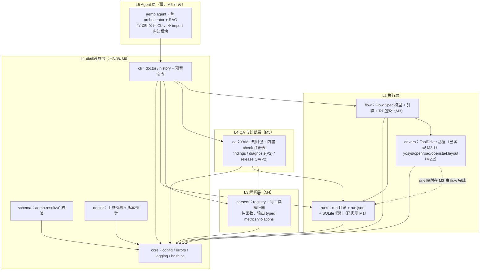
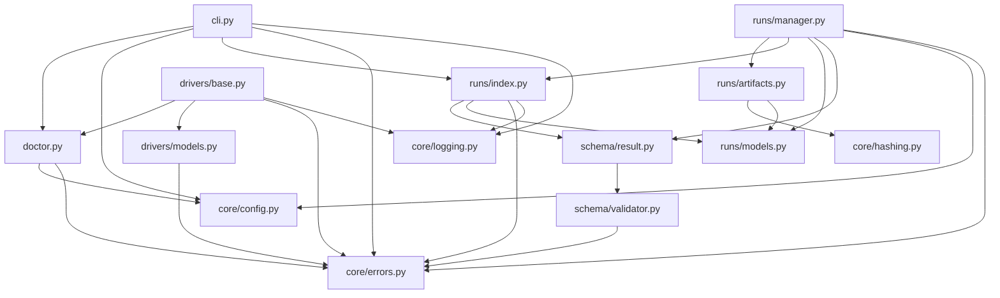

# AI EDA Methodology & QA Platform —— 架构文档（As-Built + Planned）

> **历史快照（M1/M2.1 时期）**：本文记录早期实现态，未覆盖 M2.2–M5 与 M6.0；
> 三端边界与 API 契约请见 [docs/03-architecture.md](03-architecture.md)。
> 状态：代码现状快照，2026-10-07
> 定位：本文是 [docs/01-opensource-analysis-and-architecture.md](01-opensource-analysis-and-architecture.md)
> 的**实现态补充**——docs/01 回答"为什么这样设计"（选型、许可证、ADR、MVP 边界），
> 本文回答"现在实际长什么样、数据如何流动、下一步模块落在哪"。
> 两文冲突时以 docs/01 的决策与 [AGENTS.md](../AGENTS.md) 的硬约束为准，并以同 PR 修正。

---

## 1. 项目定位

面向数字 IC methodology 工程师的**确定性 EDA 流程自动化与 QA 平台**（Python 包 `aemp`）：

```
YAML Flow Spec → Yosys/OpenROAD/OpenSTA/KLayout 子进程执行
              → 报告解析为带单位/带溯源的 typed metrics
              → YAML 规则包 QA → run 历史（文件系统为事实，SQLite 为索引）
```

AI Agent 是**边缘薄层**（M6 可选）：只能通过公开 CLI 行动，永不进入确定性数据路径；
没有 LLM 平台也必须能端到端运行。

### 快速事实

| 项 | 值 |
|---|---|
| 包名 / 版本 | `aemp` / 0.2.0（`pyproject.toml`） |
| Python | >= 3.11；目标平台 Linux（本地用 WSL2），代码平台中性，工具链不承诺 Windows |
| 运行时依赖 | `PyYAML>=6.0`、`jsonschema>=4.18`（parser 子系统计划零第三方依赖） |
| 存储 | `runs/<run_id>/` 文件系统为 source of truth；`runs/index.sqlite3` 仅为可重建索引 |
| 数据契约 | `aemp.result/v0`（JSON Schema draft 2020-12，`src/aemp/schema/result_v0.json`） |
| CLI 已实现 | `aemp doctor`、`aemp history`；`run/parse/qa/ask` 为预留桩（exit 2） |
| 当前里程碑 | 按 AGENTS.md §9：**M2.1（driver 基座）已完成，M2.2 具体 driver 未开始** |
| 测试 / CI | 10 个单元测试文件（无需 EDA 工具）；GitHub Actions：pytest（3.11/3.12）+ ruff |

---

## 2. 设计原则（来自 docs/01 §3.1，实现必须服从）

| 原则 | 含义 |
|---|---|
| P1 确定性内核优先 | LLM 不在执行路径；MVP 无 LLM 也能跑完全流程 |
| P2 只有一个 Agent | 单 orchestrator + Markdown skill 知识库，不做 agent 动物园 |
| P3 双状态分离 | "进程跑完" ≠ "工程通过"；缺证据 = `unknown`，永不误判为 fail/pass |
| P4 可追溯 | finding → rule → metric → artifact(sha256) → run → tool version，3 步内回溯 |
| P5 结构化优先 | 优先工具原生 JSON 输出，文本 regex 为降级路径且**必须对账** |
| P6 依赖极简 | runtime 依赖目标 ≤ 4 个 |
| P7 文件是事实，SQLite 是索引 | 数据库可随时由 run 目录重建 |
| P8 规则即数据 | QA 规则用 YAML + 内置校验函数注册表，不发明 DSL |
| P9 fail-fast 前移 | 每 step 前廉价断言，昂贵错误秒级暴露 |
| P10 诚实测量 | 平台无权修改 metric；measured 与 estimated/scaled 永远分列 |

---

## 3. 里程碑状态（计划 vs 代码现状）

| 里程碑 | 范围 | 状态 |
|---|---|---|
| M0 | 工程基座：config/errors/logging/hashing/schema 校验/CI | ✅ 完成 |
| M1 | `aemp.result/v0` envelope + run 目录 + 证据记录 + SQLite 索引 + `history` | ✅ 完成 |
| M2.1 | `ToolDriver` 子进程治理基座（request/result 值类型） | ✅ 完成 |
| M2.2 | 具体 driver：yosys / openroad / opensta（klayout 占位）+ registry | ⬜ 未开始 |
| M3 | Flow 引擎 v0（YAML spec → 线性步骤 + envelope 映射） | ⬜ 未开始 |
| M4 | Report parsers（typed metrics + 对账） | ⬜ 未开始 |
| M5 | QA Rule Engine v0（YAML 规则包 + findings） | ⬜ 未开始 |
| M6 | 最小 Agent（可选，仅 CLI） | ⬜ 未开始 |
| Phase 2 | RAG、诊断深化、sweep、Library/PDK QA、Release QA、DAG、Postgres、Dashboard | ⬜ backlog |

代码中**尚不存在**的包目录（不要假设可用）：`src/aemp/flow/`、`src/aemp/parsers/`、
`src/aemp/qa/`、`src/aemp/agent/`。`configs/flows/`、`configs/rules/`、`examples/`、
`tests/integration/` 目前只有 `.gitkeep`。

---

## 4. 总体分层架构（目标态，L1–L5）



**依赖方向硬规则**（AGENTS.md §4，必须无环、无回边）：

- `core` → 无内部依赖
- `drivers`、`parsers`、`runs` → `core`；`drivers` 复用 `doctor` 的可执行发现/版本探针原语
- `drivers` MUST NOT import `runs`/`schema`/`parsers`（envelope 映射由 `flow.engine`（M3）做）
- `parsers` MUST NOT 依赖 `drivers`/`flow`（纯函数）
- `flow.engine` → `drivers`、`runs`、`core`；`qa` → `parsers`、`runs`、`core`（**不依赖 drivers**）
- `agent` 只能经公开 CLI 行动，MUST NOT import 内部模块——这是把 LLM 关在 contract 外的物理保证

---

## 5. 已实现模块架构（As-Built）

### 5.1 模块依赖图（实线 = 当前代码真实 import）



### 5.2 `core` —— 基础设施层

| 模块 | 职责 | 关键点 |
|---|---|---|
| `core/config.py` | 项目根发现 + 配置加载 | `AEMP_PROJECT_ROOT` 优先；否则从 cwd 向上找 `pyproject.toml`；`Settings` 暴露 `config_dir/flow_dir/rule_dir/tool_config/runs_dir`；`load_yaml()` 仅接受映射（空文件 → `{}`） |
| `core/errors.py` | 稳定异常层级 | `AEMPError` + `ConfigurationError` / `SchemaValidationError(path, detail)` / `ToolNotFoundError(tool)` / `InvalidRequestError` / `StorageError`；CLI 只捕获 `AEMPError`，意外 bug 必须带 traceback 崩溃 |
| `core/logging.py` | 日志 | 统一 `aemp` 命名空间；`setup_logging()` 装 stderr handler（CLI 默认 INFO，`-v` 为 DEBUG）+ 可选 DEBUG 文件 handler（为 run 级日志预留的缝） |
| `core/hashing.py` | SHA-256 | `sha256_bytes()`；`sha256_file()` 按 1 MiB 分块流式读取，GB 级工件内存恒定 |

### 5.3 `schema` —— 结果契约

- `schema/validator.py::validate_json()`：draft 2020-12 通用校验；先校验 schema 自身合法性；
  按路径排序取第一个错误，抛 `SchemaValidationError`，错误消息形如
  `path=data.metrics.wns` + `message=...`。
- `schema/result.py`：`SCHEMA_VERSION = "aemp.result/v0"`；`load_result_schema()`（lru_cache 读取
  包内 JSON）；`validate_result()`。
- `schema/result_v0.json`：**封闭外层**（`additionalProperties: false`）+ 开放内层（`metrics`
  为任意对象）。版本演进规则：只发新版本，禁止原地改这个文件（AGENTS.md §10.8）。

### 5.4 `runs` —— run 管理、证据与索引（M1 核心）

**写序纪律**（manager.py 模块 docstring，硬约束）：

```
1. 建 runs/<run_id>/ 目录树
2. 写 run.json（每次写前 validate_result）
3. 注册 inputs/artifacts（每次注册都会重写 run.json）
4. 最后才 upsert SQLite 索引行
```

索引永远不能声称一个目录不存在的 run。

| 模块 | 职责 | 关键点 |
|---|---|---|
| `runs/models.py` | 常量与值类型 | run 生命周期 `created/running/success/failed`（`running` 留给 M3）；envelope 词表 `execution/engineering ∈ {success, failed, unknown}`；`FileRecord`（frozen dataclass，`to_dict()` 与 schema 的 fileRecord 一致） |
| `runs/artifacts.py` | 文件证据指纹 | `record_file(path, role, base)`：相对路径按 base 解析；存在 → `bytes + sha256`；缺失 → `exists=false` 且**无 bytes/sha256**（绝不伪造哈希）；路径存储优先 base 相对 POSIX，工作区外才记绝对路径 |
| `runs/manager.py` | `RunManager.create_run()` / `Run` 句柄 | 见下 |
| `runs/index.py` | SQLite 索引（stdlib `sqlite3`） | `runs` + `artifacts` 两表；`upsert_run()` / `record_artifact()` / `list_runs(limit)`；`rebuild(runs_dir)` 从 `runs/*/run.json` 全量重建，坏目录警告跳过、绝不删除 |

`Run` 句柄 API：

| 方法 | 语义 |
|---|---|
| `add_input(path, role)` | 注册输入；缺失文件记为 `exists=false` 的**证据缺口**，不是失败 |
| `add_artifact(path, role)` | 注册产物；文件不存在 → `InvalidRequestError`（声明了的输出必须存在） |
| `freeze_file(src, name="flow.spec.frozen.yaml")` | 把配置**逐字节复制**进 run 目录并记哈希——run 可脱离当前工作区复现；记入 `inputs`，role=`flow_spec` |
| `finalize(status, engineering_status="unknown", engineering_summary=None)` | `status ∈ {success, failed}`；写入 `execution.status`、`engineering.*`、`provenance.finished_at/run_status`；然后更新索引 |

run id：`YYYYMMDDTHHMMSSZ-<6 hex>`（UTC、可读、无需 DB 唯一）；显式 id 必须匹配正则且不冲突；
自动生成最多重试 5 次。`create_run()` 建 4 个子目录：`logs/ artifacts/ results/ qa/`。

### 5.5 `drivers` —— 子进程治理基座（M2.1）

**唯一入口纪律**：平台内每个 EDA 工具进程都必须经 `ToolDriver.execute()` 启动，
其他代码不得直接调用 `subprocess`（AGENTS.md §11.1）。

`drivers/models.py` 值类型：

- `ToolExecutionRequest(tool_name, argv, cwd, env, timeout_s)`：`argv` 是**参数向量**（首元素为程序），
  构造时校验非空/非空串/超时为正；`command` 属性仅供展示，永不被重新解析。
- `ToolExecutionResult`：纯**执行事实**（argv、exit_code、duration_ms、bounded stdout/stderr、
  字节总数、截断标志、timed_out），**不含任何 QA 语义**；`succeeded` 仅表示 exit 0。

`drivers/base.py::ToolDriver.execute()` 的治理行为：

| 治理项 | 实现 |
|---|---|
| 无 shell | `subprocess.Popen(list(argv), ...)`，`shell=True` 永久禁止 |
| 进程组 / 超时 | 显式 timeout；到期 `killpg(SIGKILL)`（POSIX，`start_new_session=True` 保证能触及孙进程），失败回落 `process.kill()`；Windows 仅 kill 子进程 |
| 有界捕获 | 双线程 drain 到 EOF（防管道死锁）；每流只存 head 8 KiB + tail 32 KiB，`total_bytes` 精确计数全部字节，`truncated` 标志——内存有界远低于宪法 16 MiB 上限 |
| stdin | `DEVNULL`，子进程永不阻塞等待交互输入 |
| 环境 | `env=None` 继承父环境；传 mapping 则**整体替换**（白名单闭包环境在 M2.2 具体 driver 落地） |
| 结果语义 | 只有启动问题抛异常（`ToolNotFoundError`、cwd 不存在 `InvalidRequestError`、OS 拒绝启动的 `OSError` 原样上抛）；非零退出码/超时都是**记录下来的结果**，不是异常、不是假成功 |
| 版本探针 | `get_version()` 复用 `doctor.probe_version`，UNKNOWN 永不猜测 |

`drivers` 刻意**不 import** `runs/schema/parsers`——execution 块与 tool 块的 envelope 映射由 flow 引擎（M3）完成。

### 5.6 `doctor` —— 环境诊断（M0）

- 工具表来自 `configs/tools/tools.yaml`（`executable` + `version_args`），每个工具独立配置，
  避免代码中的 if/else 链：yosys `-V`、openroad `-version`、opensta（可执行名 `sta`）`-version`、klayout `-v`。
- `find_executable()` = `shutil.which`；`probe_version()`：30s 超时，取 stdout 再 stderr 的第一行非空输出，
  截断至 200 字符；失败/超时/无输出 → `UNKNOWN`。
- 语义：工具被找到即 `OK`；`Overall = READY` 当且仅当所有声明工具均 `OK`；退出码 `0 = READY`、`1 = NOT READY / 已处理错误`、`2 = 预留命令`。

### 5.7 `cli` —— 命令面

| 命令 | 状态 | 行为 |
|---|---|---|
| `aemp doctor` | 已实现 | 打印诊断报告；READY → 0，否则 1 |
| `aemp history [--limit N]` | 已实现 | 读 SQLite 索引列最近 run（默认 20）；空 → `No runs found.`；`limit < 1` → `InvalidRequestError` |
| `aemp run/parse/qa/ask` | 预留桩 | 打印 "planned for Mx"，退出码 2 |

---

## 6. 核心数据契约：`aemp.result/v0`

每个 run / step 一份 envelope，落盘 `run.json`，写前必过 schema 校验。

### 6.1 字段（实现版）

| 字段 | 类型/取值 | 说明 |
|---|---|---|
| `schema` | 常量 `aemp.result/v0` | 版本标识 |
| `run_id` | `^[0-9]{8}T[0-9]{6}Z-[0-9a-f]{6}$` | UTC 时间戳 + 短随机 |
| `step_id` | string \| null | null = run 级（M1）；M3 起为 step 级 |
| `operation` | 非空 string | 本次运行做什么 |
| `tool` | `{name, version, path, argv[]}` | `version` 由工具自报或 `"unknown"`，**绝不推断** |
| `execution` | `{status, exit_code, duration_ms, command, cwd, log_path, log_bytes, log_truncated}` | `status ∈ {success, failed, unknown}`；**只答"进程跑没跑"** |
| `engineering` | `{status, summary}` | `status ∈ {success, failed, unknown}`；**只答"工程断言成不成立"**，与 execution 独立 |
| `inputs[]` / `artifacts[]` | `fileRecord` 数组 | 见 6.2 |
| `metrics` | 开放 object | 由 M4 parser 写入，人/LLM 不得手填（AGENTS.md §5） |
| `diagnostics[]` | `{severity ∈ info/warning/error, code, message}` | 解析失败、超时等说明 |
| `provenance` | `created_at`（必填）`+ finished_at / run_status / aemp_version / host / python_version / platform` | 运行来源信息 |

**双状态语义（最重要）**：`execution.status: success` 永不蕴含 `engineering.status: success`；
证据缺失/不可信 → `unknown`，既不是 fail 也不是 pass。零退出码不是工程结论。

### 6.2 `fileRecord` 条件约束

```
required: role, path, exists          additionalProperties: false
exists=true  → 必须携带 bytes + sha256      （真实读过的文件）
exists=false → 禁止出现 bytes / sha256      （未读过的文件不携带任何指纹）
```

### 6.3 run 目录布局

```
runs/<run_id>/                 # 文件系统 = source of truth，.gitignore 排除
├── run.json                   # aemp.result/v0 envelope（run 级）
├── flow.spec.frozen.yaml      # 冻结的配置副本（逐字节复制 + sha256）
├── logs/                      # 每步原生日志（M3 起）
├── artifacts/                 # 报告 / metrics.json / netlist 等
├── results/                   # 每步 envelope：step-01-*.result.json（M3 起）
└── qa/                        # findings.json + run report（M5 起）
runs/index.sqlite3             # SQLite 查询缓存，可由 runs/*/run.json 重建
```

### 6.4 SQLite 索引（可重建缓存）

| 表 | 主键 | 列 |
|---|---|---|
| `runs` | `run_id` | status, created_at, started_at, finished_at, operation, engineering_status, run_dir |
| `artifacts` | `(run_id, role, path)` | `exists`(int), bytes, sha256 |

`rebuild()`：清空后从排序过的 `runs/*/run.json` 重放；schema 非法的目录**警告跳过、绝不删除**；
返回值 = 成功索引的 run 数。read API 仅 `list_runs(limit)`。

---

## 7. 关键数据流（已实现部分）

### 7.1 `aemp doctor`

```
CLI → discover_settings()（env / pyproject 向上查找）
    → load_tool_specs(configs/tools/tools.yaml)
    → 每个工具：shutil.which → OK/MISSING；probe_version → 自报版本 / UNKNOWN
    → render_report → 退出码 0/1
```

### 7.2 `RunManager.create_run()`（文件系统先于索引）

```
create_run(operation, inputs, flow_spec, tool_name, run_id)
  1. 校验 operation；解析/生成 run_id
  2. mkdir runs/<id>/{logs,artifacts,results,qa}
  3. 构造初始 envelope（execution/engineering 均 unknown，version unknown）
  4. [可选] freeze_file(flow_spec) → 复制 + 记哈希
  5. 逐个 add_input()（缺失 → exists=false，无哈希）
  6. _write_envelope()：validate_result → 写 run.json
  7. index.upsert_run(status=created)（索引第二，绝不先行）
```

### 7.3 `ToolDriver.execute()`（M2.1）

```
execute(request)
  → _resolve_program(argv[0])   # 绝对路径必须存在；裸名走 PATH；失败抛 ToolNotFoundError
  → 校验 cwd
  → Popen(argv, stdin=DEVNULL, pipes, 无 shell, POSIX 新会话)
  → 双线程有界 drain（head/tail + 总字节 + 截断）
  → wait(timeout)：到期 killpg → timed_out=True，exit_code 记 None
  → status = success 当且仅当 exit_code==0 且未超时
  → 返回 ToolExecutionResult（纯执行事实）
```

M3 的 flow 引擎将把该结果映射为 `execution`/`tool` 块，并把 `timed_out` 转成 diagnostic。

---

## 8. 目录与配置布局

```
configs/
├── flows/      # Flow Spec（YAML，M3 消费；当前仅 .gitkeep）
├── rules/      # QA 规则包（YAML，M5 消费；当前仅 .gitkeep）
└── tools/tools.yaml          # doctor 的工具表（唯一已填充配置）
data/                         # 仅合成样例：demo_design.v + demo_flow.yaml（非真实 flow spec）
runs/                         # run 数据，.gitignore 排除（/runs/ 锚定，不误伤 src/aemp/runs/）
examples/                     # 端到端示例（Phase 1 目标，空）
scripts/demo_m1.py            # M1 教学演示：跑通 create→freeze→hash→finalize→索引→重建
tests/unit/                   # 10 个测试文件，纯函数 + 假工具（sys.executable）
tests/integration/            # 有工具链才跑（当前空）
third_party/NOTICE.md         # 三方登记：PyYAML(MIT)、jsonschema(MIT)；无 vendored 代码
```

---

## 9. 测试与 CI

- `python -m pytest`：无需任何 EDA 工具即可全绿。
- `ruff check src tests`（line-length 100，py311，规则 `E,F,W,I,B,UP`）。
- CI（`.github/workflows/ci.yml`）：Ubuntu 上 Python 3.11/3.12 跑 pytest，另跑 lint；**不安装 EDA 工具**。
- driver 测试用 `sys.executable -c "<code>"` 当假工具——真实子进程、跨平台、零工具依赖。
- 集成测试在缺工具链时必须**响亮 skip**；doctor 只报缺失、绝不猜测。

---

## 10. 强制不变量清单（改代码前必读）

1. 确定性内核先行：no LLM in the core data path。
2. `execution.status: completed/success` 永不蕴含 `engineering.status: pass`。
3. 缺失/不可信证据 = `unknown`，永不 fail / 永不 pass。
4. 指标只能来自带 SHA-256 的 artifact，禁止手填/外推/LLM 生成。
5. 文件系统是事实；SQLite 仅索引；`rebuild()` 必须始终可重建。
6. 写序：run 目录 + `run.json` 先，索引行后。
7. 未读过的文件不携带哈希（`exists=false` 且无 bytes/sha256）。
8. 工具版本自报或 UNKNOWN，绝不推断。
9. 所有 EDA 进程只能经 `ToolDriver.execute()`；`shell=True` 永久禁止。
10. 每个执行必须有界：显式超时 + 有界输出 + stdin 分离。
11. Schema 只按新版本演进，禁止原地修改 `result_v0.json`。
12. 时间戳一律 UTC ISO 8601；GPL/无证代码零复制（clean-room 纪律）。

---

## 11. 已知差距与文档同步项（诚实清单）

| # | 差距 | 影响 | 建议 |
|---|---|---|---|
| G1 | `index.py` docstring 与 AGENTS.md §2 声称 WAL，但 `_connect()` **未执行** `PRAGMA journal_mode=WAL` | 并发/耐久性与文档不符 | 在 M3 前补 PRAGMA，或修正文档 |
| G2 | `ToolDriver` 的闭包环境（白名单）未实现：`env=None` 继承父环境 | 未满足 AGENTS.md §1"每次启动白名单 env" | 随 M2.2 具体 driver 落地并强制 |
| G3 | launch 前输入 SHA-256 复验（TOCTOU guard）未实现 | resolve→launch 窗口内输入可被替换 | M2.2 driver 在 `execute` 前对声明输入复验 |
| G4 | 自由文本 ≤4000 字符约束未写进 schema（`engineering.summary`、`diagnostics[].message` 无 `maxLength`） | 长文本可无界落盘 | 下一版 schema（v1）收紧，或 M4 落地时统一 |
| G5 | 实现版 `engineering.status` 词表为 `success/failed/unknown`，docs/01 §3.5 示意为 `pass/fail/unknown/not_applicable` | 语义一致（双状态 + unknown），仅词表差异 | M5 QA engine 落地时统一词表并按需发 schema v1 |
| G6 | README §4 仍写 "M1 current"，未反映 M2.1 已合入 | 文档滞后 | 更新 README 状态段 |
| G7 | `runs/` 中包含演示 run（含 `provenance.aemp_version: 0.1.0`），工作区未提交/未清理 | 无功能影响 | 由使用者在本地清理（`.gitignore` 已兜底） |

---

## 12. 扩展点（下一批代码落在哪）

| 里程碑 | 新文件/目录 | 必须遵守 |
|---|---|---|
| M2.2 | `src/aemp/drivers/{yosys,openroad,opensta,klayout}.py` + `registry.py` | 一切子进程经 `ToolDriver.execute`；闭包 env 白名单；输入在 launch 前复验 sha256；UNKNOWN 版本语义 |
| M3 | `src/aemp/flow/{spec,engine,render}.py`；`configs/flows/*.yaml` | envelope 映射只在此层；spec 冻结副本；step 前廉价断言；Tcl 模板确定性渲染 |
| M4 | `src/aemp/parsers/{base,registry,*.py}` + `tests/fixtures/reports/<tool-version>/` | 纯函数、零第三方依赖、golden fixture、计数对账（不一致 → unknown + diagnostics） |
| M5 | `src/aemp/qa/{engine,checks,*.yaml}` + `qa/` 产物 | 规则即数据；finding 3 步可回溯；missing metric → unknown |
| M6 | `src/aemp/agent/` | 只能 subprocess 调公开 CLI；请求/响应全留痕；不得 import 内部模块 |

验收路径（docs/01 §6）：`aemp run configs/flows/counter_nangate45.yaml` 一键端到端 →
每步 envelope → 解析 → 规则 QA → `aemp history` 全链路可追溯，全程无 LLM。

---

## 附录 A：源码地图（按文件）

```
src/aemp/
├── __init__.py            版本（importlib.metadata，源码树回落 0.0.0+unknown）
├── __main__.py            python -m aemp
├── cli.py                 argparse：doctor / history / 预留桩；退出码 0/1/2
├── doctor.py              工具定位 + 版本探针 + 报告渲染
├── core/
│   ├── config.py          Settings、项目根发现、load_yaml
│   ├── errors.py          AEMPError + 5 个具体异常
│   ├── hashing.py         sha256_bytes / sha256_file（流式）
│   └── logging.py         aemp 命名空间日志 + 文件 handler 缝
├── schema/
│   ├── validator.py       validate_json（draft 2020-12）
│   ├── result.py          load_result_schema / validate_result
│   └── result_v0.json     aemp.result/v0 JSON Schema
├── runs/
│   ├── models.py          run 状态常量 + FileRecord
│   ├── artifacts.py       record_file（路径/大小/哈希，缺失不伪造）
│   ├── manager.py         RunManager / Run（写序纪律）
│   └── index.py           RunIndex（两表 + rebuild）
└── drivers/
    ├── models.py          ToolExecutionRequest / ToolExecutionResult
    └── base.py            ToolDriver（子进程治理唯一入口）
```

## 附录 B：相关文档

- [AGENTS.md](../AGENTS.md)——项目宪法（硬约束、许可证红线、各里程碑纪律）
- [docs/01-opensource-analysis-and-architecture.md](01-opensource-analysis-and-architecture.md)——选型分析、ADR、MVP 边界与风险清单
- [README.md](../README.md)——快速开始、CLI 用法、路线图
- [third_party/NOTICE.md](../third_party/NOTICE.md)——第三方登记
